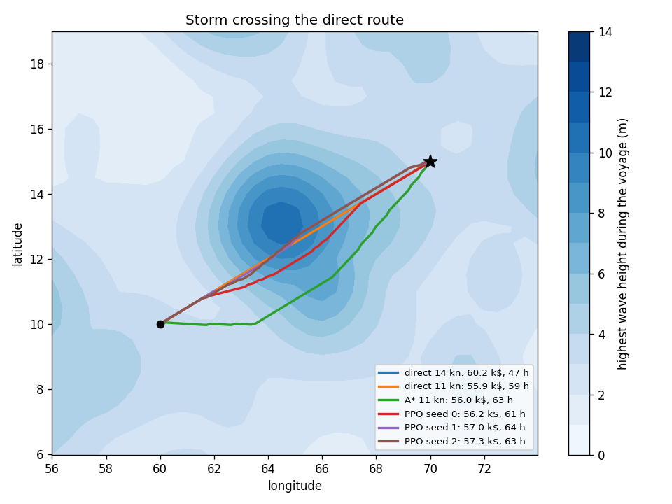

# Ship weather routing with reinforcement learning

[](https://github.com/Vaibhavtripathi7/ship-route-optimization/actions/workflows/ci.yml)
[](https://www.python.org/downloads/release/python-3120/)

A merchant ship pays for every hour at sea and for every tonne of fuel it
burns. Fuel per hour climbs steeply with speed and with wave height, and the
storms that raise the waves move while the ship is underway. This project asks
whether a PPO agent that picks course and speed every hour from a forecast can
beat simple and classical routing on that cost, and measures the answer on
voyages and weather it never trained on.

## How it works

| module | what it does |
|:-|:-|
| `weather.py` | Seeded synthetic forecasts on a 0.5° grid, every 3 hours for 10 days: smooth trade winds and swell, wind sea from the Pierson-Moskowitz relation, and drifting cyclonic storms. |
| `physics.py` | Resistance of a Panamax bulk carrier: ITTC-57 friction line with a form factor, STAWAVE-1 added resistance in waves, apparent wind drag along the hull. Fuel follows from delivered power at 180 g/kWh. |
| `env.py` | Gymnasium environment. Every hour the agent holds course, turns 15° to either side, or changes speed by one knot within 8 to 18 kn. It sees distance and bearing to the goal, its speed, the headwind and wave height where it is, and forecast wave height at six points up to 150 nm ahead, taken at the time it would get there. |
| `astar.py` | A* over a 16 connected grid, costing each leg with the forecast for the hour the ship reaches it. |
| `policies.py` | The policies being compared, and `sail()`, which runs any of them through the same environment so every voyage is costed by the same simulator. |
| `train.py` | PPO from Stable-Baselines3, three seeds of 1M steps each, on random voyages over 24 training forecasts. |
| `evaluate.py` | Runs every policy on 101 held out voyages and writes `results/`. |
| `service.py` | FastAPI service that routes a voyage with any of the planners. |

The reward is the voyage cost. Each hour the agent pays for fuel at $600 a
tonne and for charter hire at $500 an hour, and is credited $150 for every mile
it makes good towards the destination. The credit is a potential difference, so
it does not change which arrival is cheapest; it only makes the signal dense.
Leaving the forecast area or running out of forecast forfeits the credit for
the miles still to go.

## Results

Every policy was run on 101 voyages whose weather it never saw in training:
60 open sea voyages with random weather, 40 with a storm placed to cross the
direct route just as a 14 kn ship gets there, and the case plotted below. All
of them sail through the same simulator. The baseline is a rhumb line at 14 kn,
what a ship would do without any routing. Figures are the mean change in voyage
cost against that baseline over the same voyages, with a 95% confidence
interval. Full tables are in [results/summary.md](results/summary.md) and every
voyage is in [results/voyages.csv](results/voyages.csv).

| policy | open sea | storm crossing |
|:-|-:|-:|
| direct 11 kn | -6.55% ± 0.57 | -5.98% ± 0.75 |
| A* 11 kn | -4.98% ± 0.65 | -7.55% ± 1.47 |
| PPO seed 0 | -6.40% ± 0.56 | -5.91% ± 1.03 |
| PPO seed 1 | -6.57% ± 0.59 | -7.08% ± 1.33 |
| PPO seed 2 | -6.46% ± 0.64 | -5.97% ± 0.82 |
| best fixed speed, chosen in hindsight | -6.98% ± 0.54 | -7.56% ± 1.38 |

What this says:

- Most of the saving on offer comes from speed, not from the path. Going
  direct at 11 kn, the cheapest constant speed in calm water, saves 6 to 6.5%.
  Picking the best constant speed for each voyage in hindsight adds about half
  a point on open sea.
- PPO found that speed by itself. On open sea all three seeds land on the
  11 kn baseline, but none of them beats it.
- When a storm crosses the route, A* planning on the full forecast is the best
  router, about 1.6 points better than going direct. Picking the right
  constant speed is worth just as much: the best fixed speed in hindsight
  matches A*, and in 24 of the 40 voyages it is slower than 11 kn, so the storm
  has moved on by the time the ship gets there. One PPO seed gets most of that
  gain; the other two do no better than going direct. That spread between
  seeds is why three were trained.
- On open sea A* does worse than going direct. Its 16 connected grid adds up to
  3% distance, and the waves it steers around are rarely worth the detour.
- Neither planner is meaningfully faster: A* plans a voyage in 15 to 40 ms
  (median), and the PPO policy spends 26 to 38 ms on inference over a whole
  voyage.



In this storm case A* passes south of the storm, PPO seed 0 edges south and
seeds 1 and 2 hold close to the direct line. Going straight at 11 kn still
came out cheapest here: a detour has to save more fuel than its extra hours
cost.

PPO trains with γ = 1 because voyage cost is not discounted. A first run with
γ = 0.995 learned to sail about a knot too fast, since discounting makes
progress credit earned early worth more than fuel burned later. Every seed
reaches full arrival within about 50k of its 1M training steps; the curves are
in `results/learning_curve_seed*.png`.

## Running it

Needs Poetry and Python 3.10 to 3.12; numpy 1.26 has no wheels for newer
versions.

```bash
poetry install
poetry run pytest
poetry run python -m ship_routing.train 0    # about 8 minutes on 8 cores, repeat for seeds 1 and 2
poetry run python -m ship_routing.evaluate   # about a minute, rewrites results/
```

The service loads `artifacts/ppo_seed0.zip` and routes against a synthetic
forecast:

```bash
docker build -t ship-routing .
docker run -p 8000:8000 ship-routing
curl localhost:8000/route -H "Content-Type: application/json" \
  -d '{"start": [10, 60], "goal": [15, 70], "planner": "astar"}'
```

`planner` is `ppo`, `astar` or `direct`; the last two also take `speed_knots`.
The response carries the track, fuel, hours, cost and the time spent deciding.

## Limitations

- The weather is synthetic. It has the right structure, smooth fields and
  moving storms, but not real statistics. A real forecast would plug in as
  another `WeatherField`.
- Every sea is treated as a head sea, which overcharges beam and following seas.
- One ship type, no land, no traffic separation schemes, no seakeeping limits.
- Decisions are hourly and the ship turns at most 15° an hour.
- Geometry is a local flat earth, which is accurate to well under one percent
  for these distances and latitudes.

## Earlier version

The first version of this repository claimed a 56.6% fuel saving over
traditional routing and a 40x speedup over A*. Neither held up when I went back
and checked:

- The storm in that benchmark was added to a forecast hour the simulation never
  read, so neither route was affected by it.
- The saving came from the agent slowing to 5 kn and taking 3.7 times as long,
  against a baseline fixed at 15 kn, with no cost for time.
- The A* and RL timings were for different voyages, and most of the A* time
  went into per cell xarray lookups.

This rewrite fixes each of those: time has a price, storms sit in the forecast
the ship actually sails through, every policy is costed by the same simulator,
and every result above can be regenerated with the commands under Running it.

## License

[MIT](LICENSE)
